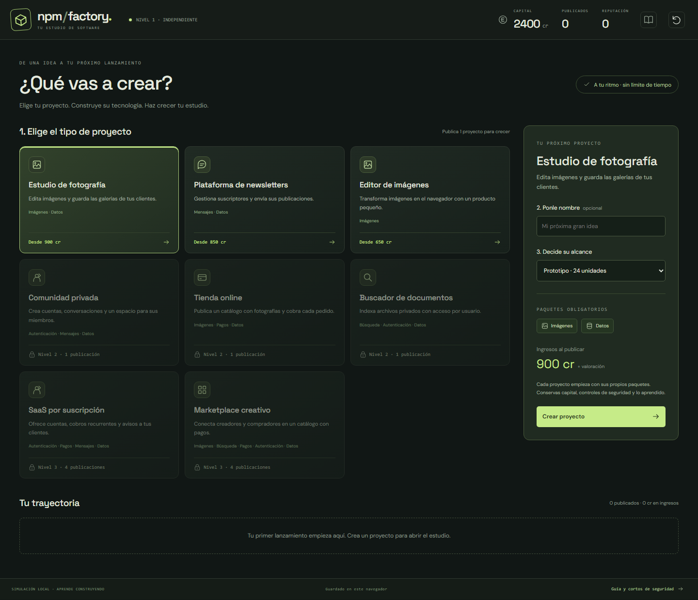
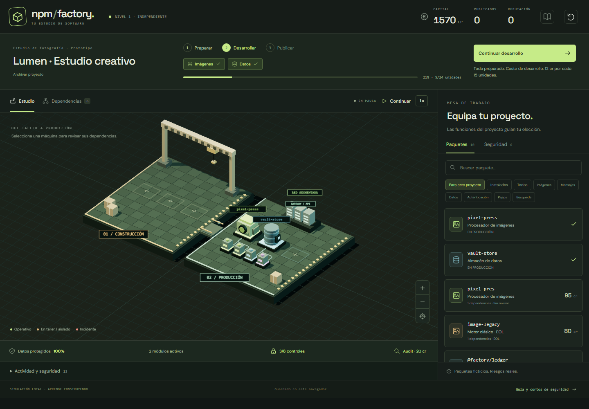
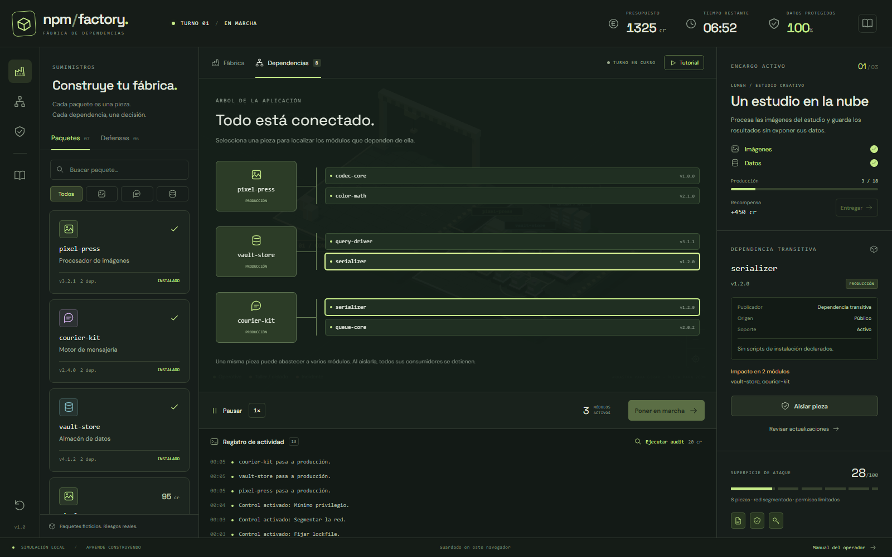
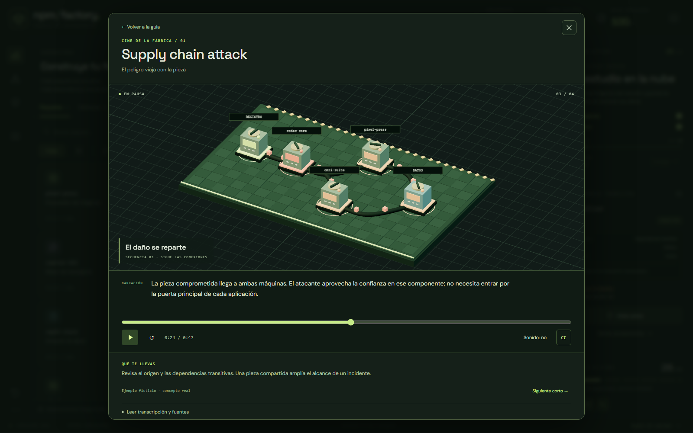

# Fábrica de dependencias

Juego de gestión de un estudio de software en Three.js, inspirado en el ciclo de proyectos de Game Dev Tycoon. Propón productos, elige los tipos de paquetes que necesitan, desarrolla y publica para financiar nuevas ideas. No hay turnos ni cuenta atrás. Cada máquina representa un paquete npm; sus conexiones muestran dependencias compartidas.

## Capturas de pantalla

### Planificación del estudio

Ocho tipos de proyecto, tres alcances predefinidos, tamaño a medida y desbloqueos al publicar y ampliar la capacidad del estudio. Cada idea exige su propio conjunto de categorías de paquetes.



### Fábrica en 3D

Vista general con las máquinas en producción, el catálogo filtrado por requisitos y la siguiente acción del proyecto.



### Mapa de dependencias

El mapa permite seleccionar una dependencia compartida y consultar qué módulos dependen de ella.



### Cine de la fábrica

Los cortos educativos combinan escenas 3D, narración en español, subtítulos y controles de reproducción.



## Ejecutar

Requiere Node.js 22 o superior y npm.

```sh
npm ci --ignore-scripts
npm run dev
```

Abre http://localhost:3036. El servidor escucha únicamente en la máquina local. Puedes cambiar el puerto mediante `PORT`.

```sh
npm test
npm run build
```

El build crea `dist/`, con Three.js y OrbitControls incluidos. Publica esa carpeta en cualquier alojamiento estático con HTTP(S), también bajo un subdirectorio con URL terminada en `/`. Puedes comprobar el resultado con `npm run preview` (puerto 3036; detén antes el servidor de desarrollo o elige otro `PORT`). No necesita backend, claves ni servicios externos. Las fuentes de Google son opcionales y tienen alternativas del sistema. La publicación se realiza en [fabrica.jonatancheca.com](https://fabrica.jonatancheca.com/) mediante Cloudflare Pages, conectado a `jonahaley/FabricaDeDependencias`: cada push a `main` ejecuta `npm run build` con Node.js 22 y publica `dist/`.

## Jugar

1. Elige un tipo de proyecto, ponle nombre y decide su alcance. Empiezas con fotografía, newsletters y editor de imágenes. Una publicación desbloquea comunidad, tienda y buscador; cuatro desbloquean SaaS y marketplace.
2. Prepara los paquetes obligatorios de imágenes, mensajes, datos, autenticación, pagos o búsqueda. El catálogo se filtra para el proyecto; puedes pulsar un requisito para ver sus alternativas. La suite básica solo cubre imágenes, mensajes y datos.
3. Inspecciona identidad, scripts, soporte y origen. Instala en el taller, activa controles de seguridad, autoriza los builds legítimos y pon las máquinas en producción. La preparación no consume mantenimiento.
4. Pulsa **Desarrollar proyecto** cuando estén operativas todas las funciones. Los alcances Prototipo, Producto y Plataforma requieren 24, 54 y 84 unidades. **A medida** permite cualquier tamaño entero desde 24 unidades hasta la capacidad instalada. Desde el primer nivel, el máximo depende exclusivamente de los puntos de construcción. Cada punto de producción aporta 1 unidad por segundo; puedes comprar más puestos, pausar o duplicar el ritmo con el control 2×. Cada pieza cuesta 2 créditos por cada 15 unidades de desarrollo.
5. Los incidentes pausan automáticamente el desarrollo. Usa el mapa para localizar consumidores, aísla, rota credenciales y reconstruye desde una versión confiable; sustituye paquetes maliciosos o EOL. Los datos ya filtrados no se recuperan.
6. Publica con al menos el 80% de los datos, sin incidentes abiertos ni credenciales filtradas. Cobras los ingresos previstos más una bonificación por la valoración de seguridad. El historial muestra ingresos y beneficio, descontando toda la inversión del proyecto.

La carrera no termina tras un número fijo de proyectos. Conservas capital, reputación, puntos de construcción y producción, controles del estudio e inspecciones realizadas. Cada nuevo proyecto empieza con paquetes y datos nuevos, y con sus propios eventos de seguridad. Puedes archivar una idea sin recuperar su inversión; si te quedas sin capital, el botón de reinicio permite fundar otro estudio.

Hay diez paquetes y seis controles de seguridad. No se gasta capital por esperar durante la preparación, en pausa o con el desarrollo completado. Espacio pausa; arrastrar gira la cámara; la rueda hace zoom. La actividad y la superficie de ataque están en un panel desplegable. La guía conserva las explicaciones y los diez cortos.

La partida se guarda en localStorage con la clave `npm-factory-v2`; recargar o cambiar de pestaña pausa el desarrollo. La guía y las revisiones de versión también lo detienen. Los guardados anteriores permanecen bajo `npm-factory-v1`, sin reutilizar su campaña incompatible.

El **Tutorial guiado** está visible sobre el planificador y el proyecto, y también se puede iniciar desde la guía. Sus 29 pasos recorren la elección del proyecto, los puntos de construcción y producción, el alcance, los requisitos, los paquetes, la seguridad, la ampliación del proyecto, el desarrollo y la publicación. Usa un estudio de práctica independiente: el reloj solo avanza en los pasos indicados, con el mantenimiento y los incidentes reales del juego. Puedes salir, recargar o repetirlo sin sustituir tu estudio; una partida en desarrollo queda en pausa. Al terminar se muestra el informe de publicación y lo que se conserva entre proyectos.

Para comprobar el juego, el tutorial y los cortos:

```sh
npm test
node tests/browser-studio.mjs /ruta/a/playwright/index.mjs
node tests/browser-tutorial.mjs /ruta/a/playwright/index.mjs
node tests/browser-films.mjs /ruta/a/playwright/index.mjs
```

## Puntos de construcción

El estudio empieza con un punto permanente y capacidad para proyectos de hasta 30 unidades. Cada ampliación añade 30 unidades de capacidad; no acelera el desarrollo ni genera mantenimiento adicional.

| Puntos instalados | Coste de la ampliación | Capacidad total | Alcance disponible |
| --- | --- | --- | --- |
| 1 | Incluido al empezar | 30 unidades | Prototipo: 24 unidades |
| 2 | 350 créditos | 60 unidades | Producto: 54 unidades |
| 3 | 3.500 créditos | 90 unidades | Plataforma: 84 unidades |
| 4 | 35.000 créditos | 120 unidades | A medida: hasta 120 unidades |
| 5 | 350.000 créditos | 150 unidades | A medida: hasta 150 unidades |

Compra desde **Puntos de construcción** en el planificador o bajo la fábrica. En la vista 3D también puedes pulsar la siguiente parcela con su precio. Las ampliaciones no tienen un límite de puestos: cada compra cuesta diez veces la anterior (350, 3.500, 35.000, 350.000 créditos…). Con `n` puntos instalados, el siguiente cuesta `350 × 10^(n − 1)` créditos. Sin capital suficiente la compra queda bloqueada. El selector de alcance solo exige capacidad de construcción; el nivel sigue desbloqueando tipos de proyecto.

El panel y la fábrica muestran los últimos cinco puestos y la siguiente parcela; los anteriores se agrupan, conservando toda su capacidad. Los precios muy grandes usan notación científica para caber en pantalla. Las partidas existentes conservan todos sus puestos y aplican la nueva progresión de precios a las compras siguientes.

Publicar o archivar conserva los puntos. Si amplías durante un proyecto, el coste se incluye en su inversión y su beneficio; comprar puntos no cambia automáticamente el alcance ni el progreso de ese proyecto. Puedes usar **Ampliar proyecto** para aprovechar la capacidad disponible. Los guardados v2 anteriores reciben, sin cobro, la capacidad necesaria para el mayor alcance de sus proyectos activos o de su historial. Los estudios nuevos empiezan con un punto.

## Proyectos a medida y recompensas

Selecciona **A medida** e introduce las unidades que quieres desarrollar, o pulsa **Usar toda la capacidad**. Cada punto de construcción permite 30 unidades: 4 puntos permiten 120, 10 permiten 300 y 1.000 permiten 30.000. No hay un tope fijo de tamaño. El tamaño utiliza toda la capacidad instalada desde el primer nivel. Los desbloqueos por experiencia solo afectan a los tipos de proyecto.

El planificador muestra los ingresos antes de crear el proyecto. Los tres tamaños base mantienen sus recompensas. Para un tipo con precio base `B` y un alcance de `u` unidades, los ingresos base se redondean al crédito:

- Entre 24 y 54 unidades: `B × (1 + 0,6 × (u − 24) / 30)`.
- Desde 54 unidades: `B × (1,6 + 0,7 × (u − 54) / 30)`.

Por ejemplo, un estudio de fotografía paga 900 cr por 24 unidades, 2.070 cr por 84, 2.826 cr por 120 y 3.456 cr por 150, más la bonificación de seguridad. Cada unidad adicional aumenta la recompensa y el trabajo requerido; el mantenimiento sigue descontándose del beneficio.

Con un proyecto activo, **Ampliar proyecto** en el panel de construcción aumenta su alcance hasta la capacidad de tus puntos de construcción y muestra los créditos adicionales antes de pulsarlo. Conserva paquetes, progreso, inversión y eventos de seguridad. También puedes ampliar un proyecto terminado antes de publicarlo; tendrás que desarrollar las unidades adicionales para cobrar. No puedes reducir el alcance para omitir trabajo. Las partidas y el historial conservan el tamaño y los ingresos pactados.

Los proyectos grandes avanzan por bloques hasta el siguiente incidente, cobro que agote el presupuesto o final del trabajo, sin recorrer cada unidad individualmente. Esto mantiene la respuesta de la interfaz incluso con mucha capacidad y producción.

## Puntos de producción

El estudio incluye un puesto de producción que desarrolla 1 unidad por segundo con el reloj a 1×. Cada puesto adicional suma otra unidad por segundo: dos puestos producen 2, tres producen 3, etc. El control 2× multiplica ese ritmo; por ejemplo, tres puestos a 2× desarrollan 6 unidades por segundo.

La primera ampliación cuesta 350 créditos; las siguientes, 3.500, 35.000, 350.000… No hay límite de puestos. El precio depende solo de los puestos de producción instalados, de forma independiente a construcción. Se compran desde el planificador, bajo la fábrica o pulsando la siguiente parcela del área 3D de producción.

Los puestos se conservan al publicar, archivar y recargar. Las partidas anteriores reciben un puesto incluido sin descontar capital ni alterar su avance. Una compra durante un proyecto cuenta como inversión y acelera desde el siguiente paso de desarrollo.

La aceleración respeta el mantenimiento de 2 créditos por pieza y cada 15 unidades producidas. Procesa los incidentes en sus unidades exactas (22, 35 y 52), se detiene inmediatamente cuando uno pausa el juego o se agota el capital, y nunca supera el trabajo pendiente. La preparación, la pausa y la espera para publicar siguen sin consumir recursos. Los últimos cinco puestos se representan individualmente; los anteriores siguen aportando toda su velocidad.

## Modelo didáctico

### Cine de la fábrica

El **Manual del operador / Guía de seguridad** incluye diez cortos de 40–51 segundos. Cada concepto tiene una escena isométrica 3D continua: las piezas viajan por las conexiones, aparecen incidentes y se cierran barreras. La cámara acompaña la explicación. También puedes abrir el corto desde cada concepto desplegable de la guía.

Incluyen narración sintética en español ya grabada, subtítulos, reproducción y pausa, reinicio, búsqueda por tiempo, silencio, transcripción y enlaces a las fuentes. Los MP3 se sirven localmente con el juego, sin servicios de voz en tiempo de ejecución. La partida se mantiene detenida durante la guía y los cortos. Cambiar de pestaña pausa también el reproductor; cerrar o volver a la guía cancela audio y animación.

Se cubren supply chain attack, scripts de instalación, EOL, zero-day, superficie de ataque, typosquatting, dependency confusion, mínimo privilegio, lockfile y límites de npm audit. La preferencia de movimiento reducido muestra composiciones estáticas por secuencia conservando la voz y los subtítulos. Si WebGL no está disponible, siguen funcionando el audio, los controles y la transcripción.

Los guiones están en `src/films.js`; la dirección 3D en `src/film-scene.js`; el reproductor en `src/film-player.js`. Para regenerar la voz tras cambiar un guion, ejecuta `node scripts/narrate-films.mjs` con Node.js 22 o superior y las dependencias de desarrollo instaladas. Esta operación opcional envía los guiones educativos a Microsoft Edge TTS mediante `node-edge-tts`; usa la voz `es-ES-ElviraNeural`. Genera `src/audio/*.mp3` y las duraciones de `src/film-audio.js`. El build normal solo copia estos recursos, sin generar voz ni usar la red.

Todos los nombres, versiones, vulnerabilidades y registros del catálogo son ficticios. La aplicación no instala los paquetes representados, no ejecuta sus scripts y no accede a secretos. Los eventos son deterministas para poder enseñar y repetir decisiones:

- `pixel-pres` imita a `pixel-press`: su script intenta robar secretos en el taller; bloquear scripts no elimina su código malicioso en ejecución.
- `@factory/ledger` se resuelve desde un registro público ficticio si el scope no se fija antes de instalar. Configurarlo después no limpia la pieza instalada.
- `image-legacy` está fuera de soporte y contiene una vulnerabilidad conocida en `codec-legacy`. EOL por sí solo no implica infección.
- A las 22 unidades de desarrollo de cada proyecto, el fallo conocido del codec EOL puede explotarse si es accesible.
- A las 35 unidades, una dependencia activa sin parche sufre un zero-day. El aviso aparece después de descubrir el fallo, no en el audit previo. En este escenario se publica una corrección al detectarlo; en la realidad esa disponibilidad no está garantizada.
- A las 52 unidades, un rebuild de `codec-core` sin lockfile puede resolver una versión comprometida. Esto representa una resolución flotante, no un comportamiento universal de `npm install`.
- El lockfile fija el árbol, pero no garantiza que su contenido sea seguro. Una actualización explícita también puede introducir la candidata maliciosa.
- El control de red bloquea el vector remoto concreto del escenario. No representa protección universal frente a zero-days. El aislamiento del taller modela ausencia de secretos y de salida de red, no una garantía general de cualquier sandbox.
- Mínimo privilegio reduce el daño. Aislar detiene la propagación y también las funciones dependientes. Rotar secretos no recupera los datos ya robados.
- El índice de superficie de ataque combina componentes, entradas y permisos. Es una ayuda visual del juego, no una métrica real de vulnerabilidad.
- `npm audit` simulado solo informa de avisos conocidos. No certifica paquetes ni detecta todas las formas de código malicioso.

## Estructura

- `src/game.js`: estado y reglas deterministas, sin dependencias del navegador.
- `src/catalog.js`: paquetes, defensas, tipos y tamaños de proyecto, y lecciones.
- `src/scene.js`: escena isométrica, maquinaria, conexiones, animación y selección con raycasting.
- `src/tutorial.js`: práctica guiada del estudio, con estado independiente y avance por acciones.
- `src/main.js`, `src/style.css` y `src/studio.css`: interfaz, accesibilidad, guardado y controles.
- `scripts/server.mjs`: servidor de desarrollo sin dependencias adicionales.
- `scripts/build.mjs`: empaquetado estático.
- `tests/game.test.mjs`: escenarios de prevención, incidentes, dependencias, recuperación y carrera continua.
- `tests/studio.test.mjs`: requisitos, alcances, desbloqueos, economía, pausa y persistencia.
- `tests/construction.test.mjs`: ampliaciones, costes, capacidad, progresión y compatibilidad de guardados.
- `tests/production.test.mjs`: velocidad por puesto, precios, persistencia, mantenimiento e interrupción exacta por incidentes.
- `tests/project-scale.test.mjs`: alcance a medida, recompensas, ampliación de proyectos, guardado y producción de proyectos grandes.
- `tests/browser-studio.mjs`: recorrido de creación, desarrollo, publicación y recuperación en escritorio y móvil.

## Fuentes

- [npm: scripts de ciclo de vida](https://docs.npmjs.com/cli/v11/using-npm/scripts/)
- [npm audit: vulnerabilidades conocidas](https://docs.npmjs.com/cli/v11/commands/npm-audit/)
- [npm ci: instalaciones coherentes con el lockfile](https://docs.npmjs.com/cli/v11/commands/npm-ci/)
- [OWASP NPM Security Cheat Sheet](https://cheatsheetseries.owasp.org/cheatsheets/NPM_Security_Cheat_Sheet.html)
- [Node.js: fin de soporte](https://nodejs.org/en/about/eol)

La mecánica comprime el tiempo, los costes y los incidentes para favorecer el aprendizaje; no sustituye una evaluación de seguridad de un proyecto real.
